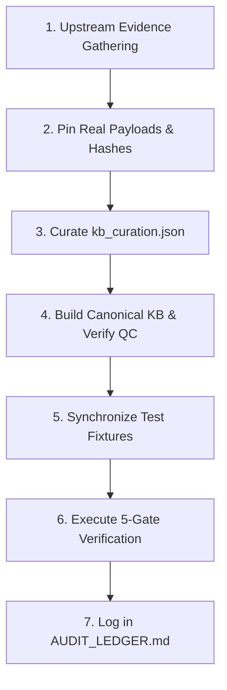

# Lucidase Database Enrichment Roadmap

> **Status:** Active Reference & Execution Plan  
> **Deployment Architecture:** Primary deployment target is **Netlify** (static edge distribution + zero-knowledge headers; `api/manifest.js` served via Netlify Functions or static manifest).  
> **Curation Engine:** Local SQLite Workbench projection (`tools/curation/curation_workbench.db` managed by `tools/curation/curation_store.py`) syncing with Git-tracked JSON (`kb_curation.json`, `evidence_claims.json`, `platform_coverage.json`) with SHA-256 session collision protection.  
> **Architecture Invariants:** Single source of truth (`tools/curation/kb_curation.json` -> `web/src/knowledge-base.json`), Anti-Corruption Layer (`tools/fixtures/upstream/real/`), Clinical Honesty (`AGENTS.md` Rule 4), Zero-Knowledge Client-Side Analysis.  
> **Current KB State:** 55 curated loci across 34 genes. Target milestone: ~80–120 curated loci.

---

## 1. Executive Summary & Core Rules

Lucidase classifies raw genomic array and VCF data directly in the browser with **zero data egress**. Every curated variant must adhere to four immutable principles:

1. **Deterministic Single Source of Truth**: All genomic loci, allele definitions, star ratings, and interpretations live exclusively in `web/src/knowledge-base.json`, built via `tools/build_canonical_kb.py` from `tools/curation/kb_curation.json`.
2. **Strict Anti-Corruption Layer**: Every upstream claim is backed by real, byte-verbatim JSON payloads pinned with SHA-256 hashes under `tools/fixtures/upstream/real/` from ClinVar, dbSNP, Ensembl VEP, and gnomAD.
3. **Clinical Honesty & Negative Invariants**:
   - Absence of an observed variant is **never** reported as "normal" or absence of disease risk; wording must read *"variant not detected among the N variants tested"*.
   - Count 0 (homozygous reference) must always have `category: "Not detected"`, `significance: "Not detected"`, and `magnitude: 0.0`.
   - Single-variant tests of multi-variant genes carry an explicit limitation banner in the table, inspector, and exports.
4. **5-Gate Verification**: Every tier addition must pass all 5 gates before commit:
   - Gate 1: `python -m pytest tests -q -p no:cacheprovider --ignore=tests/e2e`
   - Gate 2: `node --test --test-reporter=spec "web/tests/**/*.test.mjs"`
   - Gate 3: `python -m pytest tests/e2e -q -p no:cacheprovider`
   - Gate 4: `python tools/build_canonical_kb.py --verify-only`
   - Gate 5: `python tools/check_vendored_css.py`

---

## 2. Completed Tiers (Baseline to Date)

- [x] **Core Baseline (14 loci / 12 genes)**: `APOE` (rs429358 + rs7412), `HFE` C282Y (rs1800562), `HFE` H63D (rs1799945), `F5` Leiden (rs6025), `F2` Prothrombin (rs1799963), `CYP2C19` *2 (rs4244285), `VKORC1` (rs9923231), `SLCO1B1` *5 (rs4149056), `DPYD` *2A (rs3918290), `MTHFR` C677T (rs1801133), `MCM6` (rs4988235), `ALDH2` (rs671), `CFTR` ΔF508 (rs113993960).
- [x] **Tier 1A: CYP2C19 Extended Star Alleles**: `CYP2C19*3` (rs4986893), `CYP2C19*17` (rs12248560).
- [x] **Tier 1B: CYP2C9 CPIC Level A Warfarin Metabolism**: `CYP2C9*2` (rs1799853), `CYP2C9*3` (rs1057910).
- [x] **Tier 1C: DPYD Complete Fluoropyrimidine Toxicity Panel**: `DPYD*13` (rs55886062), `c.2846A>T` (rs67376798), `HapB3` tag (rs56038477).
- [x] **Tier 2A: Cardiovascular & Statin Transporters**: `CYP4F2*3` (rs2108622, completing warfarin triad), `ABCG2 Q141K` (rs2231142, rosuvastatin transport).
- [x] **Tier 4: One-Carbon Folate & Catecholamine Catabolism**: `MTHFR A1298C` (rs1801131, compound heterozygote pair), `COMT Val158Met` (rs4680, prefrontal dopamine clearance).
- [x] **Phase 1 (Tier 2B): Thiopurine Toxicity (TPMT & NUDT15)**: `TPMT*2` (rs1800462), `TPMT*3C` (rs1142345), `TPMT*3B` (rs1800460), `NUDT15*3` (rs116855232).
- [x] **Phase 2 (Tier 3): Severe Adverse Drug Reaction (ADR) HLA Immune Alleles**: `HLA-B*57:01` tag (`rs2395029`), `HLA-A*31:01` tag (`rs1061235`), `HLA-B*58:01` tag (`rs9263726` in `PSORS1C1`). `HLA-B*15:02` tag SNPs excluded per Clinical Honesty guardrails (`AGENTS.md` Rule 4).
- [x] **Phase 3: Expanded High-Value Pharmacogenomics & Enzymopathies**: `CYP2D6` core star alleles (`rs3892097` *4, `rs1065852` *10, `rs28371725` *41), `G6PD` deficiency (`rs1050828` A-, `rs1050829` A+, `rs5030868` Med), `BChE` pseudocholinesterase deficiency (`rs1799807`), `SLCO1B1` statin uptake expansion (`rs2306283` *1b).
- [x] **Phase 4: Micronutrient, Vitamin & Metabolic Pathway Modifiers**: `FUT2` (`rs601338`), `BCO1` (`rs7501331`, `rs12934922`), `PNPLA3` (`rs738409`), `FMO3` (`rs2266782`, `rs2266780`), `CBS` (`rs5742905`), `VDR` (`rs2228570`).
- [x] **Phase 5: Hereditary Disease & Secondary Findings Expansions**: `HFE` S65C (`rs1800730`), `F13A1` Val34Leu (`rs5985`), founder `BRCA1` 185delAG (`rs80357914`), `BRCA1` 5382insC (`rs80357906`), `BRCA2` 6174delT (`rs80359550`), `SERPINA1` Pi*Z (`rs28929474`), `SERPINA1` Pi*S (`rs17580`).

---

## 3. Remaining Database Enrichment Tasks

### Phase 1: Thiopurine S-Methyltransferase & Nudix Hydrolase (Tier 2B — Completed)

* **Clinical Rationale**: Thiopurine drugs (azathioprine, 6-mercaptopurine, thioguanine) are standard immunosuppressants for IBD, rheumatoid arthritis, and leukemias. Patients with inherited deficiency in `TPMT` or `NUDT15` accumulate cytotoxic thioguanine nucleotides (TGN), resulting in life-threatening, fatal myelosuppression and pancytopenia. CPIC Level A guideline and FDA boxed warning mandate pre-treatment testing or substantial dose reduction (up to 90%).
* **Inheritance Model**: Autosomal co-dominant / intermediate metabolizer risk.
* **Target Loci**:
  - [x] **`TPMT*2` (`rs1800462`)**: chr6:18143724 (GRCh38) / chr6:18143955 (GRCh37), c.238G>C (p.Ala80Pro). Rare in all populations (~0.5%), causes 100-fold reduction in protein stability.
  - [x] **`TPMT*3C` (`rs1142345`)**: chr6:18130687 (GRCh38) / chr6:18130918 (GRCh37), c.719A>G (p.Tyr240Cys). Most common deficient allele in East Asian and African populations (~2–5%).
  - [x] **`TPMT*3B` (`rs1800460`)**: chr6:18138997 (GRCh38) / chr6:18139228 (GRCh37), c.460G>A (p.Ala154Thr). Rare alone; along with `*3C` forms the composite haplotype `*3A`.
  - [x] **`NUDT15*3` (`rs116855232`)**: chr13:48045719 (GRCh38) / chr13:48619855 (GRCh37), c.415C>T (p.Arg139Cys). Critical in East Asian (MAF ~10%) and Hispanic populations where thiopurine leukopenia is driven primarily by NUDT15 rather than TPMT.
* **Upstream Sources**: ClinVar (VCV000012721, VCV000012722, VCV000225201), CPIC Level A guidelines, PharmGKB, dbSNP.

---

### Phase 2: Severe Adverse Drug Reaction (ADR) HLA Immune Alleles (Tier 3 — Completed)

* **Clinical Rationale**: Human Leukocyte Antigen (HLA) alleles drive idiosyncratic, hyper-severe T-cell-mediated hypersensitivity reactions with extraordinary odds ratios ($OR > 100$ to $1000$). Exposure in positive carriers triggers Stevens-Johnson Syndrome (SJS), Toxic Epidermal Necrolysis (TEN), or DRESS (Drug Reaction with Eosinophilia and Systemic Symptoms). Array platforms reliably genotype well-characterized tag SNPs in linkage disequilibrium with specific HLA class I alleles.
* **Clinical Honesty Guardrail**: Must explicitly disclaim that array tag SNPs are surrogates for HLA alleles and do not substitute for definitive sequence-based HLA typing.
* **Target Loci**:
  - [x] **`HLA-B*57:01` Tag (`rs2395029`)**: chr6:31464402 (GRCh38) / chr6:31432128 (GRCh37), Intronic/Intergenic tag in `HCP5`.
    - *Indication*: Abacavir (antiretroviral) hypersensitivity.
    - *Predictive Power*: 100% negative predictive value for patch-test confirmed abacavir hypersensitivity. FDA black-box warning.
  - [x] **`HLA-B*15:02` Tag (`rs3909184` or `rs2844682`)**: Excluded per Clinical Honesty guardrails (`AGENTS.md` Rule 4). Tag SNP surrogacy for HLA-B*15:02 suffers from inadequate sensitivity/specificity across non-Asian sub-populations (high false-negative rate) compared to definitive sequence-based HLA typing; clinical guidelines (CPIC) mandate sequence-based or specific allele-level genotyping before carbamazepine initiation.
  - [x] **`HLA-A*31:01` Tag (`rs1061235`)**: chr6:29942767 (GRCh38) / chr6:29910493 (GRCh37).
    - *Indication*: Carbamazepine hypersensitivity across pan-ethnic and European populations (DRESS syndrome and maculopapular exanthema).
  - [x] **`HLA-B*58:01` Tag (`rs9263726`)**: chr6:31378822 (GRCh38) / chr6:31346548 (GRCh37).
    - *Indication*: Allopurinol (gout therapy) severe cutaneous adverse reactions (SCAR) and SJS/TEN. Extremely high risk in East Asian, Thai, and African ancestries.
* **Upstream Sources**: ClinVar, CPIC guidelines (Abacavir, Carbamazepine, Allopurinol), FDA Table of Pharmacogenomic Biomarkers in Drug Labeling.

---

### Phase 3: Expanded High-Value Pharmacogenomics & Enzymopathies (Completed)

* **Target Loci**:
  - [x] **`CYP2D6` Core Array Star Alleles**:
    - *Loci*: `*4` (`rs3892097`, c.506-1G>A splice defect, ~70% of poor metabolizers in Europeans); `*10` (`rs1065852`, p.Pro34Ser, East Asian intermediate metabolizer); `*41` (`rs28371725`, c.2988G>A decreased function).
    - *Why*: Metabolizes ~25% of all clinical drugs (codeine, tramadol, tamoxifen, SSRIs, beta-blockers).
    - *Limitation*: Must strictly refuse full diplotype/metabolizer prediction due to undetectable copy number variations (CNV duplications `*1xN` and full deletions `*5`) on standard genotyping arrays.
  - [x] **`BChE` Butyrylcholinesterase / Pseudocholinesterase Deficiency (`rs1799807`)**:
    - *Locus*: chr3:165768994 (GRCh38) / chr3:165488439 (GRCh37), c.293A>G (p.Asp70Gly, Kalow/Atypical variant).
    - *Why*: Patients receiving depolarizing neuromuscular blockers (succinylcholine) or mivacurium during anesthesia develop prolonged neuromuscular blockade and prolonged apnea requiring mechanical ventilation.
  - [x] **`G6PD` Glucose-6-Phosphate Dehydrogenase Deficiency**:
    - *Loci*: G6PD A- (`rs1050828` c.202G>A + `rs1050829` c.376A>G), G6PD Mediterranean (`rs5030868` c.563C>T).
    - *Why*: X-linked enzymopathy affecting >400 million people. Acute hemolytic anemia triggered by rasburicase, primaquine, dapsone, sulfamethoxazole, nitrofurantoin, and fava beans. CPIC Level A.
  - [x] **`SLCO1B1` Expansion (`rs2306283`)**:
    - *Locus*: c.388A>G (p.Asn130Asp, `*1b`).
    - *Why*: In combination with existing `rs4149056` (`*5`), enables full differentiation of `*1a` (normal), `*1b` (enhanced), `*5` (poor), and `*15` (poor) statin uptake haplotypes.

---

### Phase 4: Micronutrient, Vitamin & Metabolic Pathway Modifiers (Completed)

* **Rationale**: Directly relevant to consumer DNA users exploring diet, B-vitamin supplementation, and metabolic efficiency.
* **Target Loci**:
  - [x] **`FUT2` Secretor Status (`rs601338`)**:
    - *Locus*: chr19:48703417 (GRCh38) / chr19:49206674 (GRCh37), c.428G>A (p.Trp143Ter nonsense variant).
    - *Why*: Non-secretors (homozygous AA / non-secretor, ~20% of Europeans) lack ABO blood group antigens on mucosal surfaces. Associated with altered gut microbiome diversity, lower serum Vitamin B12 levels, and resistance to norovirus infection.
  - [x] **`VDR` Vitamin D Receptor (FokI `rs2228570`)**:
    - *Locus*: chr12:47879112 (GRCh38) / chr12:48272895 (GRCh37), c.2T>C (start codon polymorphism).
    - *Why*: Alters translation initiation site resulting in a protein 3 amino acids shorter with altered transactivation capacity and bone mineral density modulation.
  - [x] **`BCO1` Beta-Carotene Monooxygenase (`rs7501331` & `rs12934922`)**:
    - *Why*: Regulates intestinal conversion of dietary beta-carotene into active retinol (Vitamin A). Variant carriers exhibit up to 50–70% reduced catalytic activity, requiring direct preformed retinol intake.
  - [x] **`PNPLA3` Hepatic Fat / NAFLD Susceptibility (`rs738409`)**:
    - *Locus*: chr22:43928847 (GRCh38) / chr22:44324727 (GRCh37), c.444C>G (p.Ile148Met).
    - *Why*: Major genetic modifier of hepatic triglyceride accumulation and non-alcoholic fatty liver disease (NAFLD) susceptibility.
  - [x] **`FMO3` Trimethylaminuria / Choline Metabolism (`rs2266782` & `rs2266780`)**:
    - *Why*: Modulates conversion of dietary choline-derived trimethylamine (fish odor) to odorless trimethylamine N-oxide (TMAO).
  - [x] **`CBS` Homocystinuria & Pyridoxine Response (`rs5742905`)**:
    - *Locus*: chr21:43063074 (GRCh38) / chr21:44483184 (GRCh37), c.833T>C (p.Ile278Thr).
    - *Why*: Most common pathogenic CBS mutation causing pyridoxine (B6)-responsive homocystinuria; carrier status transmits to 50% of offspring.
---

### Phase 6: Food Intolerance & Histamine Breakdown (DAO / AOC1) (Active Sprint — Target: 59 loci / 35 genes)

* **Clinical & Functional Rationale**: Encodes diamine oxidase (DAO), the primary extracellular enzyme for degrading ingested food histamine in the intestinal lumen. Reduced enzymatic activity correlates with food-induced histamine sensitivity, postprandial gastrointestinal distress, flushing, and vascular headaches.
* **Target Loci (Canonical 2024 Nutrients Benchmark, PMCID: PMC11054051)**:
  - [ ] **`DAO` / `AOC1` p.Thr16Met (`rs10156191`)**: chr7:150827299 (GRCh38) / chr7:150529241 (GRCh37), c.47C>T. Common coding variant associated with significantly reduced enzymatic activity.
  - [ ] **`DAO` / `AOC1` p.Ser332Phe (`rs1049742`)**: chr7:150854228 (GRCh38) / chr7:150556170 (GRCh37), c.995C>T. Functional missense variant altering catalytic turnover.
  - [ ] **`DAO` / `AOC1` p.His664Asp (`rs1049793`)**: chr7:150856005 (GRCh38) / chr7:150557947 (GRCh37), c.1990C>G. Functional missense variant in terminal catalytic domain.
  - [ ] **`DAO` / `AOC1` Promoter Variant (`rs2052129`)**: chr7:150826315 (GRCh38) / chr7:150528257 (GRCh37), c.-691C>T. Modulates transcriptional promoter activity.
* **Platform Coverage & Clinical Honesty**:
  - `rs2052129` is present on 23andMe v5 (e.g. user genotype `GG` = wild-type / typical expression).
  - `rs10156191`, `rs1049742`, and `rs1049793` are absent from 23andMe v5 but present on clinical/targeted panels and AncestryDNA.
  - Demonstrates strict platform-coverage transparency (`"Not on your chip"` status) and avoids false-negative "normal" calls when only a subset of the 4 benchmark loci are assayed.
* *Curation Note*: Distinguishes true `AOC1` loci from bystanders `rs1045642` (`ABCB1`) and `rs1047768` (`ERCC5`).

---

### Phase 7: Sensory, Ocular & Longevity Panel (Target: 66 loci / 40 genes)

* **Clinical & Functional Rationale**: High-magnitude actionable findings and widely replicated longevity markers with high consumer DNA interest and unambiguous biochemical mechanisms.
* **Target Loci**:
  - [ ] **`CFH` Complement Factor H Y402H (`rs1061147`)**: chr1:196659237 (GRCh38) / chr1:196621008 (GRCh37), c.1204T>C (p.Tyr402His). Major genetic risk factor for Age-Related Macular Degeneration (AMD; ~2.8x increased risk per C-allele, 11x in CC homozygotes). Key lifestyle intervention: antioxidant lutein/zeaxanthin, smoking avoidance, UV protection.
  - [ ] **`TCF4` Fuchs Endothelial Corneal Dystrophy (`rs613872`)**: chr18:55663737 (GRCh38) / chr18:53229641 (GRCh37), intronic surrogate for CTG trinucleotide repeat expansion. Major genetic determinant of Fuchs dystrophy requiring corneal transplantation; ~5x odds ratio in carriers.
  - [ ] **`LOXL1` Exfoliation Glaucoma Risk Haplotype (`rs3825942` & `rs2165241`)**: chr15:73934338 & chr15:73950462 (GRCh38). Lysyl oxidase-like 1 variants driving pseudoexfoliation fibrillar protein deposition and secondary open-angle glaucoma.
  - [ ] **`FOXO3` Centenarian Longevity Factor (`rs2802292`)**: chr6:108573130 (GRCh38) / chr6:108882956 (GRCh37), G-allele. Well-replicated biomarker associated with exceptional human longevity, enhanced cellular stress resistance, and preserved metabolic health.
  - [ ] **`ACTN3` Fast-Twitch Muscle Power vs. Endurance (`rs1815739`)**: chr11:66560624 (GRCh38) / chr11:66328107 (GRCh37), c.1729C>T (p.Arg577Ter). Absence of alpha-actinin-3 in fast muscle fibers (577XX) shifts muscle metabolism toward endurance efficiency; 577RR/RX preserves sprint and explosive power capacity.
  - [ ] **`PRNP` Prion Protein Codon 129 Polymorphism (`rs1799990`)**: chr20:4699605 (GRCh38) / chr20:4680251 (GRCh37), c.385A>G (p.Met129Val). Codon 129 heterozygosity (129MV) provides profound protective advantage against acquired and sporadic prion diseases (Creutzfeldt-Jakob disease, kuru).

---

### Phase 8: Cardiometabolic & Autoimmune Panel (Target: 72 loci / 45 genes)

* **Clinical & Functional Rationale**: High-penetrance polygenic drivers of common metabolic and autoimmune pathologies where early preventative surveillance alters clinical outcomes.
* **Target Loci**:
  - [ ] **`9p21.3` Coronary Artery Disease & Myocardial Infarction (`rs1333049`)**: chr9:22125503 (GRCh38) / chr9:22124477 (GRCh37), intergenic `CDKN2A`/`CDKN2B` non-coding RNA enhancer. Strongest common genetic locus for premature myocardial infarction and coronary atherosclerosis.
  - [ ] **`FTO` Adiposity & Metabolic Rate (`rs1121980` / `rs9939609`)**: chr16:53782363 (GRCh38) / chr16:53818616 (GRCh37), intronic enhancer modulating `IRX3`/`IRX5` thermogenesis in adipocytes. Robustly associated with basal metabolic rate and obesity predisposition.
  - [ ] **`MTNR1B` Melatonin Receptor 1B & Fasting Glucose (`rs10830963`)**: chr11:92973479 (GRCh38) / chr11:92708710 (GRCh37), intronic enhancer variant. Modulates nocturnal insulin secretion suppression and elevated fasting plasma glucose / T2D risk.
  - [ ] **`STAT4` Autoimmune Susceptibility (`rs7574865`)**: chr2:191099890 (GRCh38) / chr2:191965873 (GRCh37), intronic variant. Drives elevated STAT4 expression, predisposing to systemic lupus erythematosus (SLE) and rheumatoid arthritis (RA).
  - [ ] **`ABCG2` Hyperuricemia & Gout Risk Expansion (`rs3114018`)**: chr4:88094364 (GRCh38). Synergizes with existing `rs2231142` (Q141K) to quantify urate transporter impairment and gout risk.
  - [ ] **`TCF7L2` Type 2 Diabetes Susceptibility (`rs7903146`)**: chr10:112998590 (GRCh38) / chr10:114758349 (GRCh37), intronic variant. Single strongest common genetic risk factor for impaired beta-cell incretin response and T2D.

---

### Phase 9: Pharmacogenomic Expansion & Multi-Locus Haplotypes (Target: 80–120 loci)

* **Clinical & Functional Rationale**: Reaching the comprehensive 80–120 curated loci milestone through CPIC Level A drug targets and multi-locus haplotype resolvers.
* **Target Loci**:
  - [ ] **`CYP3A5*3` (`rs776746`)**: chr7:99672916 (GRCh38) / chr7:99245815 (GRCh37). Critical CPIC Level A marker for tacrolimus immunosuppressant dosing in organ transplantation.
  - [ ] **`CYP1A2*1F` (`rs762551`)**: chr15:74749576 (GRCh38). Inducibility of caffeine and clozapine/olanzapine metabolism.
  - [ ] **`NAT2` Slow vs. Fast Acetylator Panel (`rs1801280` *5, `rs1799930` *6, `rs1799931` *7)**: Isoniazid and hydralazine neurotoxicity and drug clearance.
  - [ ] **`GJB2` Connexin 26 Hereditary Hearing Loss (`rs80338939` / 35delG)**: Most common cause of autosomal recessive non-syndromic sensorineural deafness.
  - [ ] **`HFE` Full Compound Hemochromatosis Haplotype Engine**: Resolving all combinatorial diplotypes between C282Y (`rs1800562`), H63D (`rs1799945`), and S65C (`rs1800730`).

---

## 4. Standard Implementation Protocol (Per Tier)

When picking up any tier above, execute in the exact order below:

1. **Upstream Evidence Gathering**:
   - Query `/dbsnp-database` for exact coordinates on GRCh37/GRCh38, plus-strand ref/alt alleles, and HGVS cDNA/protein nomenclature.
   - Query `/clinvar-database` for Variation ID, VCV accession, review star status, and clinical significance.
   - Query `/gnomad-database` for global allele frequencies, sub-population allele frequencies, and gene constraint metrics (pLI, LOEUF).
   - Query `/alphagenome-single-variant-analysis` / `/alphagenome-variant-impact-score` for AVI scores and tissue-specific expression impacts.
2. **Pin Real Payloads**:
   - Add rsIDs and genes to `tools/fetch_upstream.py`.
   - Run `python tools/fetch_upstream.py` to retrieve byte-verbatim fixtures and `.meta.json` with SHA-256 hashes under `tools/fixtures/upstream/real/`.
3. **Curation in `tools/curation/kb_curation.json`**:
   - If introducing a new gene, define it under `"genes"` (`model`, `topic`, `inheritance`, `omim`, `uniprot`, `ensembl_gene_id`).
   - Define each locus under `"loci"` with coordinates, `alt_allele_counts`, interpretations (`0` = Not detected), and evidence citations.
4. **Build & Verify KB**:
   - Run `python tools/build_canonical_kb.py` (ensure 0 QC errors).
   - Run `python tools/build_canonical_kb.py --verify-only` (ensure bit-for-bit reproducibility).
5. **Fixture Synchronization**:
   - If test assertions depend on demo files, update `web/demo-data/sample-23andme.txt` and `tests/e2e/fixtures/wildtype-23andme.txt`.
   - Regenerate karyogram sample with `python tools/make_synthetic_karyogram_sample.py`.
6. **5-Gate Verification**:
   - Pytest unit tests: `python -m pytest tests -q -p no:cacheprovider --ignore=tests/e2e`
   - Node unit tests: `node --test --test-reporter=spec "web/tests/**/*.test.mjs"`
   - E2E browser tests: `python -m pytest tests/e2e -q -p no:cacheprovider`
   - Verify-only KB: `python tools/build_canonical_kb.py --verify-only`
   - Vendored CSS: `python tools/check_vendored_css.py`
7. **Audit Trail**:
   - Record remediated/added tier in [AUDIT_LEDGER.md](file:///c:/Users/peter/Python%20Projects/Thing/AUDIT_LEDGER.md) under the date header.
