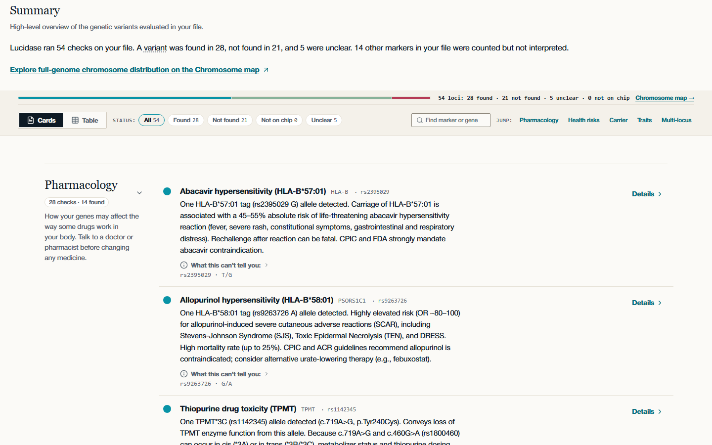
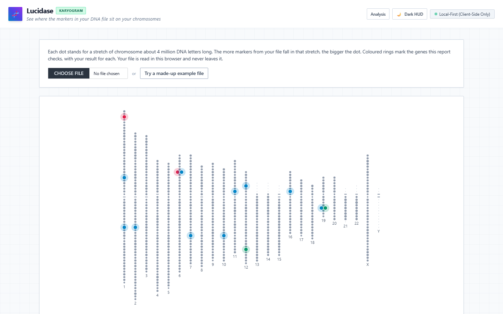

<picture>
  <source media="(prefers-color-scheme: dark)" srcset="docs/assets/lucidase-screenshot-dark.png">
  
</picture>

*The bundled synthetic demo sample, analysed in the browser.*

Lucidase reads a raw genotype file in your browser and interprets the 55 curated loci (34 genes) in its knowledge base. It says plainly what it could not test. It reads 23andMe, AncestryDNA and MyHeritage array files and VCF files, and rejects any other format with a visible error. Formerly GenomePulse.

## Karyogram view

<picture>
  <source media="(prefers-color-scheme: dark)" srcset="docs/assets/lucidase-karyogram-dark.png">
  
</picture>

`web/karyogram.html` maps a genotype file onto the chromosomes. Each dot stands for a stretch of chromosome about 4 million DNA letters long, sized by how many markers from your file fall there, and the 34 genes this report checks are marked with their coverage state. A file that doesn't say which genome version it uses is not placed on the chromosomes: the page says so and still shows the results for the genes this report checks. The map is drawn in the browser from UCSC chromosome lengths and centromeres stored in the knowledge base, and your file never leaves the page.

## What it does

- Parses the file in a Web Worker, in the page.
- Compares alleles by alt-allele count against plus-strand ref/alt. A genotype that cannot be resolved unambiguously is never reported as a match.
- Gives every curated locus one coverage state per sample: `supported_and_observed`, `supported_not_observed`, `not_tested_by_array`, `outside_coverage` or `insufficient_evidence`.
- Groups the results by Pharmacology, Health risk factors, Carrier status and Traits, one row per check in plain words (Found, Not found, Not on your chip, Unclear), each with what it can't tell you.
- Shows APOE as one composite row built from rs429358 and rs7412.
- Opens the results with a summary: the counts in one sentence, the karyogram of your file with one mark per checked locus (selecting a mark opens that result), and a key with the count for each result.
- Shows disease or recurrence figures for inheritance only at Mendelian disease loci. Other loci get allele-transmission figures only.
- Opens each result's details beside the list, and explains genetics words inline.
- Exports Markdown and CSV reports.
- Has light and dark themes.

## What it does not do

- It is not a diagnostic test and not medical advice. Absence of a finding does not imply absence of genetic risk.
- It does not sequence whole genes. It cannot detect copy-number variations, balanced translocations or structural repeats.
- A single-variant test of a multi-variant gene carries its limitation on the row, in the details pane and in every export.
- Only the curated loci are interpreted. Other markers in your file are counted, not interpreted.

See "Known limitations" in [`web/README.md`](web/README.md).

## Privacy

Your file is read and analysed in the browser and is never uploaded. The Content-Security-Policy sets `connect-src 'self'`. There are no accounts and no payments. The page currently loads its web fonts from Adobe Fonts (use.typekit.net); no genotype data is sent there.

## Run it

See [Deployment Options](web/README.md#deployment-options) and its Local Development section in [`web/README.md`](web/README.md).

## Repository map

| Area | Path | Role |
|---|---|---|
| Web app | `web/` | Parses and classifies raw DNA files in the browser. |
| Knowledge-base build | `tools/` | Builds the one curated knowledge base, `web/src/knowledge-base.json`. |
| Desktop genomics | `genomic_parser.py`, `variant_annotator.py`, `segregation_engine.py`, `biotools_orchestrator.py`, `gui.py` | Local reference implementation of the same rules. |
| de Bruijn explorer | `graph_core.py`, `assembly.py`, `bio_engine.py`, `ml_engine.py`, `debruijn_explorer.py` | Standalone assembly and graph teaching tool. |

## Development

Rules and gates are in [`AGENTS.md`](AGENTS.md). Working notes are in [`CLAUDE.md`](CLAUDE.md). The audit and its remediation history are in [`AUDIT_LEDGER.md`](AUDIT_LEDGER.md).

The `Gates` workflow (`.github/workflows/gates.yml`) runs the five gates on every pull request and every push to `main`, and pull request bodies follow [`.github/PULL_REQUEST_TEMPLATE.md`](.github/PULL_REQUEST_TEMPLATE.md). Run `python -m pip install pre-commit` and then `pre-commit install` once per clone.

`python run.py` serves `web/` on localhost and opens the app (`--port N`, `--no-browser`).

## About the name

Lucidase is *lucid* plus *-ase*, the enzyme suffix, as in Promethease. The arch from the c to the dot of the i in the wordmark is a ligature, and "ligature" and "ligase", the enzyme that joins DNA strands, share a root. The dot field in the banner is a stylised karyogram.
